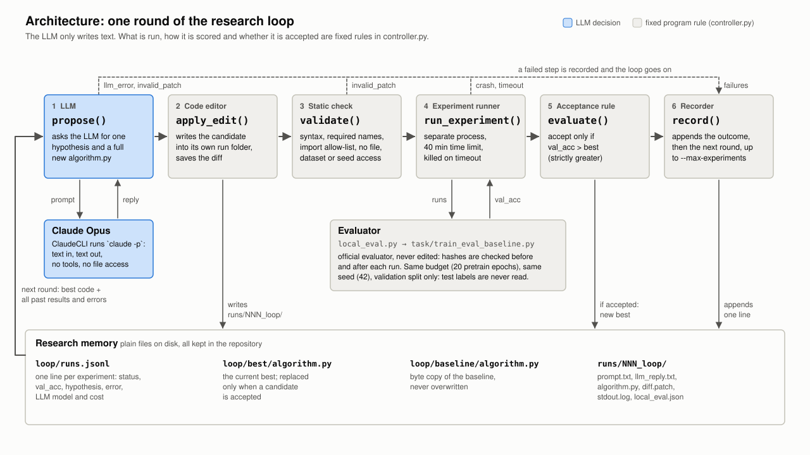
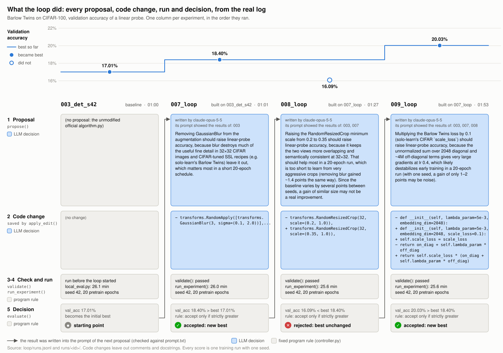
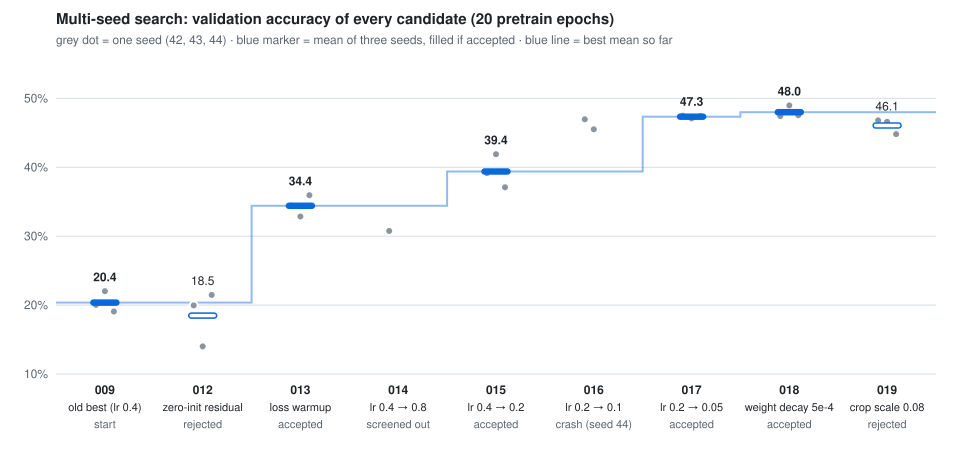

# Automated researcher — take-home

A minimal autonomous research loop (Propose → Modify → Execute → Evaluate → Record → Repeat)
on the FML-bench task `Representation_Learning_solo_learn` (Barlow Twins on CIFAR-100).

| Part | Where |
|---|---|
| 1 — baseline, noise and seed study | [below](#part-1--baseline) |
| 2 — the loop and its real run | [below](#part-2--the-research-loop), [controller.py](controller.py), [loop/runs.jsonl](loop/runs.jsonl) |
| 2A / 3 — architecture diagram and timeline of the real run | [docs/figures.md](docs/figures.md) |
| Beyond the brief — a pilot run that changes three things at once (9 GPU hours), and a final report on the hidden test split | [below](#pilot-run-beyond-the-brief-three-changes-at-once-2026-11-25), [loop_multiseed/runs.jsonl](loop_multiseed/runs.jsonl) |
| 4 — main limitation and one controlled improvement: exploration at a fixed ratio | [below](#part-4--main-limitation-and-one-controlled-improvement), [docs/part4.md](docs/part4.md) |
| Disclosure — LLM use, packages, human intervention, failures, reused code | [below](#disclosure) |
| Slides (English and Chinese) | [slides/](slides/): `automated-researcher-v2-en.pptx` and `-zh.pptx`, built by [slides/make_slides_v2.js](slides/make_slides_v2.js) (`npm install pptxgenjs`); a few pages of the Chinese deck were then laid out by hand |

## Environment

| | |
|---|---|
| GPU | NVIDIA GeForce RTX 3060 Ti, 8 GB (driver 576.57) |
| CPU / RAM | AMD Ryzen 5 3600 (6 cores) / 32 GB |
| OS | Windows 10 Home 19045, run natively (no WSL) |
| Python env | conda `sololearn`: Python 3.10, torch 2.1.0+cu121, torchvision 0.16.0+cu121, numpy 1.26.4 — see [environment.yml](environment.yml) |

```
conda env create -f environment.yml
```

## Task source

[task/](task/) is a verbatim copy of FML-bench `ml_tasks/Representation_Learning_solo_learn`
at commit `d336651` (see [task/SOURCE.md](task/SOURCE.md)). The official evaluator
`task/train_eval_baseline.py` is never modified (SHA-256 `6a4f78b4…a1d682`).

## Reduced-compute local evaluator

The official config trains for 130 pretrain epochs (~2.7 h per experiment on this GPU).
[local_eval.py](local_eval.py) runs the official evaluator unchanged and overrides only the
compute-budget keys of `get_training_config()`, so the baseline and every candidate use the
same declared budget regardless of what the LLM writes:

| Budget key | Official | Declared (this repo) |
|---|---|---|
| `pretrain_epochs` | 130 | **20** |
| `linear_eval_epochs` | 100 | 100 |
| `batch_size` | 512 | 512 |
| `linear_batch_size` | 256 | 256 |

Fixed by the official evaluator: global seed 42, linear-probe seed 100, split
`val_ratio=0.057, val_seed=42` (49,979 train / 3,021 validation images). `local_eval.py`
refuses to run if `train_eval_baseline.py` or `split_config.json` differ from the official
copies, and only exposes `--split val`, so the 7,000 hidden test images are never used
for selection. Unlike FML-bench, the LLM is not allowed to edit `split_config.json`.

## Part 1 — baseline

### What the baseline does

**Barlow Twins (pretraining, no labels).** Every training image is randomly augmented
twice (crop, flip, colour jitter, grayscale, blur), giving two views of the same image.
Both views go through the same network: a ResNet-18 backbone (512-d features) followed
by a 3-layer projector (2048-d embeddings). Over a batch, the loss builds the
2048 × 2048 cross-correlation matrix between the embeddings of view 1 and view 2 and
pushes it towards the identity matrix:

- diagonal → 1: each embedding dimension gives the same answer for both views, so the
  representation ignores the augmentations and keeps what the image is about;
- off-diagonal → 0 (weighted by `lambda_param = 5e-3`): different dimensions carry
  different information, which prevents the trivial solution where every image gets
  the same output.

Unlike contrastive methods, it needs no negative pairs and no momentum encoder.
The code is in [task/algorithm.py](task/algorithm.py) (`BarlowTwinsLoss`, `BarlowTwinsModel`).

**Linear evaluation (the score).** Pretraining has no accuracy of its own, so the
quality of the representation is measured afterwards. The projector is discarded and the
backbone is frozen. A single linear layer (512 → 100 classes) is trained on the frozen
features with the training labels (SGD, lr 0.1, 100 epochs), and its accuracy on the
3,021 validation images is the reported number. A linear layer cannot learn new features,
so a higher accuracy means the backbone itself has organised the images better. This
protocol lives in the official evaluator (`linear_eval()` in `task/train_eval_baseline.py`)
and is the same for every experiment.

**One possible modification.** Add a learning-rate warmup to pretraining: start with
small steps and climb to the full rate over the first epochs. Reason: the evaluator uses
plain SGD with a cosine schedule that starts at the full `lr` of 0.4 with no warmup,
while the Barlow Twins paper warms up for its first 10 epochs. The seed study below
shows that two of three seeds end pretraining with almost twice the loss of the third,
which suggests that the first steps are too large for some initialisations. A warmup
targets exactly those steps, costs no extra compute, and can be written inside the file
the loop is allowed to change (the schedule belongs to the evaluator, but scaling the
loss in the first steps has nearly the same effect with SGD). Lowering `lr` for the
whole run is the cruder alternative for the same diagnosis. It is a hypothesis to test,
not a result.

### Baseline runs

```
python local_eval.py --workdir runs/001_baseline --pretrain-epochs 20
```

Each run directory holds copies of `algorithm.py`, `train_eval_baseline.py` and
`split_config.json`, plus a `data` junction to a shared CIFAR-100 download.

| Run | Code | Budget | Val accuracy | Wall time |
|---|---|---|---|---|
| [001_baseline](runs/001_baseline/) | unmodified `algorithm.py` | 20 ep | **18.80%** | 25.1 min |
| [002_baseline_repeat](runs/002_baseline_repeat/) | identical, same seeds | 20 ep | **17.51%** | 25.1 min |
| (official, reference only) | unmodified | 130 ep | 47.77% | — |

**Run-to-run noise.** Two identical runs differ by 1.29 percentage points; pretrain losses
already differ at epoch 1. [tools/determinism_check.py](tools/determinism_check.py) shows
why: input batches are bit-identical across runs (same data and augmentation), the first
loss is identical, and losses diverge from the second step, i.e. after the first
backward pass. Enabling PyTorch deterministic mode removes the difference.

### Deterministic mode and seed-to-seed variation

`local_eval.py` now runs in deterministic mode by default and accepts `--seed`
(seeds other than 42 are used only to measure variation, never for selection).

```
python local_eval.py --workdir runs/003_det_s42 --pretrain-epochs 20 --seed 42
```

| Run | Seed | Pretrain loss, epoch 20 | Val accuracy | Wall time |
|---|---|---|---|---|
| [003_det_s42](runs/003_det_s42/) | 42 | 745.94 | **17.01%** | 26.1 min |
| [004_det_s42_repeat](runs/004_det_s42_repeat/) | 42 | 745.94 | **17.01%** | 26.5 min |
| [005_det_s43](runs/005_det_s43/) | 43 | 1317.68 | **9.47%** | 26.1 min |
| [006_det_s44](runs/006_det_s44/) | 44 | 1422.32 | **9.53%** | 26.2 min |

- Runs 003 and 004 are bit-identical (same losses, accuracy and checkpoint SHA-256):
  deterministic mode makes the full experiment reproducible at ~4% extra wall time.
- Across seeds 42/43/44 the baseline gives 17.01% / 9.47% / 9.53%. This is two groups,
  not a spread around a mean: two of three seeds train much worse (mean 12.0%, sample
  std 4.3 pp, n=3, reported only for completeness). The gap appears in pretraining (much
  higher final loss for seeds 43/44), not in the linear probe. Our unverified hypothesis:
  lr 0.4 without warmup makes early training unstable for some initialisations, and
  seed 42 is a favourable one.
- For reference, the binomial standard error of an accuracy near 17% on 3,021
  validation images is about 0.7 pp.

**Consequence for the loop.** Selection uses seed 42 in deterministic mode, so
comparisons are exactly reproducible and follow the brief's "strictly exceeds under the
same conditions" rule. The initial best is `003_det_s42` (17.01%).

Deterministic mode makes a score repeatable; it does not make it precise. Runs 001, 002
and 003 are the same code with the same seed and score 18.80%, 17.51% and 17.01%: tiny
differences in GPU arithmetic alone move the result by up to 1.8 points. Deterministic
mode freezes one such outcome. As soon as a candidate changes the code, the arithmetic
changes and the outcome is drawn again. So a difference of one or two points between a
candidate and its parent is within what the unchanged baseline does by itself, on top
of the much larger differences between seeds. This is why the pilot run below trains
every candidate on three seeds.

Timing runs (1 and 2 epochs) are in [runs/000_timing](runs/000_timing/); the first one
includes the CIFAR-100 download.

Note: `001_baseline` ran with CRLF copies of the task files (a Windows checkout artifact,
fixed before `002`); Python executes them identically.

## Part 2 — the research loop

[controller.py](controller.py) runs the loop: propose → apply edit → validate → run →
evaluate → record. The LLM only writes the text of a new `algorithm.py`; what is run, how
it is scored and whether it is accepted are fixed rules in the controller.



The step-by-step table (function per step, LLM decision or fixed rule) is in
[docs/figures.md](docs/figures.md).

```
python controller.py --max-experiments 3
```

This starts from `runs/003_det_s42` as the initial best and uses the same evaluator
command as Part 1 for every candidate (20 pretrain epochs, seed 42, deterministic mode).
One experiment takes about 26 minutes on this GPU. Restarting the command with the same
`loop/` folder resumes from the log.

### Result of the real run (2026-11-24)

| Run | Parent | Change proposed by the LLM | Val accuracy | Decision | Diff |
|---|---|---|---|---|---|
| [003_det_s42](runs/003_det_s42/) | — | unmodified baseline | 17.01% | initial best | — |
| [007_loop](runs/007_loop/) | 003 | remove `GaussianBlur` from the augmentation | **18.40%** | accepted | [diff](runs/007_loop/diff.patch) |
| [008_loop](runs/008_loop/) | 007 | raise the minimum crop scale 0.2 → 0.35 | 16.09% | rejected | [diff](runs/008_loop/diff.patch) |
| [009_loop](runs/009_loop/) | 007 | multiply the loss by 0.1 | **20.03%** | accepted | [diff](runs/009_loop/diff.patch) |

- The best moved from 17.01% to 20.03% in three experiments (77 minutes of GPU time,
  0.24 USD of LLM usage as reported by the command line).
- 008 was rejected, so 009 was proposed from 007 again, with the failed attempt and its
  score in the prompt. This is the "use the feedback for the next proposal" step.
- 007's gain (+1.39) is not distinguishable from noise: the unmodified baseline scored
  18.80% in run 001, above 007's 18.40%. The same applies to the rejection of 008.
- 009 is close to a learning-rate change. With plain SGD, multiplying the loss by 0.1
  scales every gradient by 0.1, which is nearly the same as lowering `lr` from 0.4 to
  0.04 (weight decay is not scaled, so it becomes relatively stronger). This is not the
  warmup suggested in Part 1, which no candidate of this loop tried, but it acts on the
  same diagnosis (steps too large) by making every step smaller.
- All three loop scores come from seed 42 only. Whether the final best holds on other
  seeds was checked afterwards: see [the seed check](#seed-check-of-the-final-best-2026-11-25).



The timeline is generated from the log by [tools/make_figures.py](tools/make_figures.py);
[docs/figures.md](docs/figures.md) walks through the rejected run 008 and what the loop
did next.

### Seed check of the final best (2026-11-25)

After the loop had finished, its final best (`runs/009_loop/algorithm.py`, unchanged)
was trained on the two seeds that the loop never used. These runs were started by hand
and played no part in any accept/reject decision.

```
python local_eval.py --workdir runs/010_best009_s43 --pretrain-epochs 20 --seed 43
python local_eval.py --workdir runs/011_best009_s44 --pretrain-epochs 20 --seed 44
```

| Seed | Baseline | Final best (009) | Difference |
|---|---|---|---|
| 42 (used for selection) | 17.01% ([003](runs/003_det_s42/)) | 20.03% ([009](runs/009_loop/)) | +3.02 |
| 43 | 9.47% ([005](runs/005_det_s43/)) | **22.01%** ([010](runs/010_best009_s43/)) | +12.54 |
| 44 | 9.53% ([006](runs/006_det_s44/)) | **19.07%** ([011](runs/011_best009_s44/)) | +9.54 |
| mean | 12.00% | 20.37% | +8.37 |

- The final best is above the baseline on all three seeds, and the two seeds on which
  the baseline trained badly now reach the same level as seed 42 (19–22% instead of
  9.5%). Its three scores lie within 3 points of each other.
- This fits the instability hypothesis of Part 1: 009 lowers the effective step size
  by a factor of 10, and the seeds that suffered most gain most. It is support, not
  proof: three seeds, one budget (20 epochs), and no run that isolates the cause.
- 009 contains two changes (no blur, loss × 0.1). The check does not say how much each
  contributes; 007 and 008 were not run on other seeds.
- The +3.0 points measured at seed 42 understated the benefit, because seed 42 was the
  one seed on which the baseline already trained well. A single-seed rule could not
  have known this in either direction.
- These are validation scores. The test scores of the same six runs are in the final
  report of the next section.

Where to look:

| File | Content |
|---|---|
| [loop/runs.jsonl](loop/runs.jsonl) | one line per experiment: hypothesis, status, score, best before/after, model, token usage |
| `runs/NNN_loop/prompt.txt`, `llm_reply.txt` | the full prompt sent to the LLM and its unedited reply |
| `runs/NNN_loop/diff.patch`, `algorithm.py` | the change against its parent, and the candidate file |
| `runs/NNN_loop/stdout.log`, `local_eval.json` | evaluator output and score |
| [loop/baseline/](loop/baseline/), [loop/best/](loop/best/) | the untouched baseline and the current best `algorithm.py` |

### Pilot run beyond the brief: three changes at once (2026-11-25)

The loop above is the Part 2 deliverable and is unchanged. Reviewing it showed three
things that could be better:

| Opportunity | Round 1 (the loop above) | Pilot run |
|---|---|---|
| Feedback to the LLM | one line per candidate: status, score, hypothesis (and the error text of a failed run) | also the score per seed, the changed lines, the loss of every epoch and two numbers about the features |
| When progress stalls | no rule | explore: after two candidates in a row without improvement, a different kind of change is required |
| Acceptance | one run at seed 42 above the best | mean of three seeds above the best, to rule out luck |
| *Also different:* training budget | 3 runs, the minimal demonstration | limit of 23 runs (about 9 GPU hours), 22 used, 8 candidates, starting from the best of round 1 |

All three were tried together in one run of a second mode of the same controller:

```
python controller.py --seeds 42,43,44 --max-runs 23
```

This is a pilot run, not an experiment. Several things changed at once and the budget
was larger, so it can show what happens but not why. What it gives are observations;
Part 4 turns one of them into a comparison in which only one factor changes.

It starts from the final best of the loop above (009, with its three seed scores from
runs 009, 010, 011). The rules in detail:

| | Rule (fixed in code, not decided by the LLM) |
|---|---|
| Screen | A candidate is first trained on seed 42. If it is more than 1 point below the best's score on that seed, it is dropped (`screened_out`) and costs one run. |
| Confirm | Otherwise it is also trained on seeds 43 and 44. It is accepted only if its mean over the three seeds is strictly greater than the best's mean over the same seeds. |
| Explore | After two candidates in a row that ran but were not accepted, a proposal in the category of the last failure is refused before any run. Categories: augmentation, loss, architecture, optimisation, other. |
| Stop | 23 training runs, or 40 proposals, or 5 candidates in a row without an accept, or 3 failed LLM calls in a row. |
| Feedback | The prompt lists, for every earlier candidate: the score per seed, the changed lines, the pretrain loss of every epoch, and two numbers about the learned features (effective rank, mean standard deviation). It also states the measured noise and asks for a category and for the basis of the idea (known recipe, earlier results, or both). |

The diagnostics are recorded by `local_eval.py` after the score exists. A 1-epoch run
with and without them (`--plain`) gave the same checkpoint hash, score and loss.



| Candidate | Parent | Change proposed by the LLM | Seed 42 | Seed 43 | Seed 44 | Mean | Decision |
|---|---|---|---|---|---|---|---|
| 009 (start) | — | final best of the single-seed loop | 20.03% | 22.01% | 19.07% | 20.37% | initial best |
| [012](runs/012_loop/) | 009 | ResNet with `zero_init_residual=True`, Kaiming init of `conv1` | 19.96% | 14.00% | 21.48% | 18.48% | rejected |
| [013](runs/013_loop/) | 009 | ramp the loss from 0 to full size over the first 200 steps (acts as a learning-rate warmup) | 34.43% | 32.87% | 35.95% | **34.41%** | accepted |
| [014](runs/014_loop/) | 013 | `lr` 0.4 → 0.8 | 30.75% | — | — | — | screened out |
| [015](runs/015_loop/) | 013 | `lr` 0.4 → 0.2 | 39.16% | 41.91% | 37.11% | **39.39%** | accepted |
| [016](runs/016_loop/) | 015 | `lr` 0.2 → 0.1 | 46.97% | 45.51% | crash | — | crash |
| [017](runs/017_loop/) | 015 | `lr` 0.2 → 0.05 | 47.50% | 47.10% | 47.43% | **47.35%** | accepted |
| [018](runs/018_loop/) | 017 | `weight_decay` 1e-4 → 5e-4 | 47.43% | 48.99% | 47.57% | **48.00%** | accepted |
| [019](runs/019_loop/) | 018 | minimum crop scale 0.2 → 0.08 | 46.81% | 46.61% | 44.82% | 46.08% | rejected |

- The best mean moved from 20.37% to 48.00% in 8 candidates and 22 training runs
  (9.1 GPU hours, 0.98 USD of LLM usage). The search stopped on the run budget: one run
  was left, and a candidate may need three.
- **The three-seed rule changed few decisions.** Replaying the eight candidates with
  seed 42 only (each against its own parent) gives the same accept or reject for six of
  them. It differs for 018 (accepted on the mean, 48.00% against 47.35%, but 47.43%
  against 47.50% on seed 42) and for 016 (lost to a crash on its third run; its seed-42
  score alone would have been accepted). 012 was a near tie on seed 42 (19.96% against
  20.03%) and 14.00% on seed 43, and is rejected under either rule. The steps before 018
  were 5 to 14 points, far above the noise, so any rule accepts them. The replay is
  exact only up to the first difference, because later proposals depend on earlier
  decisions. This run therefore does not show that the rule helped; it cost 22 training
  runs where one seed would have used 8.
- **The largest step echoes the modification suggested in Part 1.** 013, proposed by the
  LLM, ramps the loss scale from near 0 to its full value over the first 200 optimizer
  steps. With 009 as the starting point, the mean over three seeds rose from 20.37% to
  34.41% (+14.04 points; 11 to 17 points on every seed), the largest step of the run.
  This supports the idea behind the Part 1 hypothesis, that smaller steps early in
  training help. It is not the same operation and not a controlled test: Part 1 proposes
  a learning-rate warmup, while 013 leaves the optimizer schedule as it is and scales the
  loss (with SGD the gradient step shrinks in the same way, but weight decay does not);
  013 is compared with 009 (no blur, loss × 0.1), not with the unmodified baseline; and
  the prompt of this run states, as a fact about the fixed evaluator, that the schedule
  has no warmup, and that the baseline trained unstably on seeds 43 and 44.
- **A direction followed from the feedback.** 014 (lr up) lost 3.7 points and lowered the
  effective rank of the features (183 → 148). The next three proposals lowered the
  learning rate step by step (0.2, 0.1, 0.05), each citing the previous scores and ranks.
  This is a one-dimensional line search by the LLM, not a new idea.
- **The large gains are far outside the noise; the last one is not.** 013, 015 and 017
  each gained 5 to 14 points on every seed. 018 gained 0.65 points on the mean and was
  slightly below its parent on seed 42. With a spread of about 1.5 points between seeds,
  that step is not established. The rule accepted it because the brief's rule is
  "strictly greater"; a margin would not have.
- **016 is a failure of the machine, not of the candidate.** Its third run ended with
  Windows exit code 0xC0000409 within seconds of starting, before any training output,
  after two good scores on the other seeds. The controller
  recorded a crash and kept the best; the run was not repeated. The LLM read the error
  and went further in the same direction (017).
- **The explore rule and the patience stop were never triggered.** The search never had
  two failures in a row. They are exercised only by the unit tests and the fake run.
- **No convergence was reached.** The last two candidates gave +0.65 and −1.9, which
  suggests the easy gains from the step size are used up, but two candidates are not
  evidence of a plateau.
- All changes are standard practice (warmup, lower learning rate, more weight decay).
  The baseline's settings (lr 0.4 with plain SGD and no warmup) were far too aggressive
  for this setup, and most of the gain comes from correcting that.
- **Several things changed between the two loops, so they are not a controlled comparison.**
  The single-seed loop (007–009) and this run (012–019) differ in the acceptance rule,
  in the prompt, in the explore rule (which never fired) and in the budget: 3 training
  runs and 3 candidates against 22 runs and 8 candidates. Round 1 left running for five
  more candidates might have reached a similar score; this run cannot say.
  The prompt was the same within each loop (the saved `prompt.txt`
  files were compared) and was changed only between them. The second prompt adds how the
  evaluator calls the file, the acceptance rule and the measured noise, the changed lines,
  loss curve and feature numbers of each candidate, and a starting note that says the
  baseline trained unstably on seeds 43 and 44. That note may have pointed the LLM
  towards the warmup of 013. The move from 20% to 48% therefore cannot be attributed to
  the three-seed rule, to the richer prompt or to the longer run separately, and nothing
  here claims any of them.

**Final report on the hidden test split.** Selection used validation accuracy only.
After the search had stopped, three versions were scored once on the 7,000 held-out
test images with [tools/final_test.py](tools/final_test.py) (official `--split test`,
unchanged, on the saved backbones; linear-probe seed 200 + (seed − 42)). No decision was
made afterwards.

```
python tools/final_test.py --selection-is-finished runs/003_det_s42 runs/005_det_s43 runs/006_det_s44 runs/009_loop runs/010_best009_s43 runs/011_best009_s44 runs/018_loop/s42 runs/018_loop/s43 runs/018_loop/s44
```

| Version | Val, seeds 42 / 43 / 44 | Val mean | Test, seeds 42 / 43 / 44 | Test mean |
|---|---|---|---|---|
| Unmodified baseline (003, 005, 006) | 17.01 / 9.47 / 9.53 | 12.00% | 17.10 / 9.21 / 10.21 | 12.17% |
| Best of the single-seed loop (009, 010, 011) | 20.03 / 22.01 / 19.07 | 20.37% | 19.10 / 21.63 / 19.13 | 19.95% |
| Best of the multi-seed search (018) | 47.43 / 48.99 / 47.57 | 48.00% | 48.27 / 48.87 / 48.84 | **48.66%** |

- Test and validation agree within 1 point for every run, so selecting on the
  validation split did not produce a visibly optimistic score here.
- For orientation only: FML-bench ships 47.77% as the reference for the unmodified
  baseline at the full 130 pretrain epochs. That number was not reproduced locally and
  comes from a different budget, so it is not a controlled comparison.
- Limits: three seeds, one search run (the LLM is not deterministic), 20 epochs only.
  Whether the changes still help at 130 epochs was not tested.

Files: [loop_multiseed/runs.jsonl](loop_multiseed/runs.jsonl) (one line per candidate),
[loop_multiseed/controller_stdout.log](loop_multiseed/controller_stdout.log),
`runs/NNN_loop/prompt.txt`, `llm_reply.txt`, `diff.patch`, and one folder per seed
(`s42`, `s43`, `s44`) with `local_eval.json` and `stdout.log`; `test_eval.json` in the
nine folders of the final report.

### Reproducing

- **Multi-seed search without a GPU or an LLM:**
  `python controller.py --fake --seeds 42,43,44 --max-experiments 5` (screened out,
  rejected on the mean, refused by the explore rule, accepted, crash on a later seed).
- **Without a GPU or an LLM:** `python controller.py --fake --max-experiments 8` plays a
  scripted "LLM" against a fake evaluator in a temporary folder and exercises every
  outcome (accepted, rejected, tie, invalid patch, repeated code, crash, timeout).
  `python -m unittest test_controller -v` runs the unit tests (also no GPU, no LLM call).
- **Real run:** the LLM is called through the Claude Code command line, not through an
  API key. Install it (`npm install -g @anthropic-ai/claude-code`), run `claude` once and
  log in, then run the command above. Defaults: `--model claude-opus-5-5 --effort medium`
  (the command line reported version 2.1.330 on 2026-11-25; the version at the time of
  the run was not recorded). LLM output is not deterministic, so a new run will
  produce different proposals; the experiments themselves are reproducible from the
  saved `algorithm.py` files.

### What the LLM sees

Each call is `claude -p` with all tools, MCP servers and slash commands switched off, a
one-line system prompt that replaces the default one, no saved session, and an empty
temporary folder as working directory. The intended context is therefore the system
prompt plus `prompt.txt`. Checked on 2026-11-25:

- No user-level `CLAUDE.md` exists on this machine, and the empty working folder has no
  project instructions. Claude Code's memory is stored per working folder, and no memory
  folder exists for the temporary folders the controller used.
- The command line still adds a short block of its own that is not in `prompt.txt`:
  operating system, working folder, date, model name, and a note with the account email.
  A test call with the same flags showed this block; it contains nothing about this
  project or earlier results.
- Not verified: whether a `CLAUDE.md` would be ignored if one existed. A test with a
  marker file was inconclusive, so on another machine check that `~/.claude/CLAUDE.md`
  is absent before a real run.

### How this context compares with the referenced projects

What to send to the LLM follows the projects the brief references, OpenEvolve [5] in
particular: give it the current program, its earlier attempts and their results, so that
it can decide what to try next. The wording and the parts specific to this task (the
rules, the warning about noise, the diagnostics of the second prompt) were written for
this task. The item-by-item comparison below was made against the projects'
repositories as read on 2026-11-25.
Numbers are the brief's references:
[1] [FML-bench paper](https://arxiv.org/abs/2605.17373),
[4] [Autoresearch](https://github.com/karpathy/autoresearch),
[5] [OpenEvolve](https://github.com/algorithmicsuperintelligence/openevolve),
[6] [mini-SWE-agent](https://github.com/SWE-agent/mini-swe-agent).

| In `prompt.txt` | Closest counterpart |
|---|---|
| Rules: one editable file, fixed evaluator, what has no effect | Autoresearch [4]: the human-written `program.md` tells the agent that `train.py` is the only file it edits and that the evaluation harness must not be modified |
| Current best `algorithm.py` in full | OpenEvolve [5]: the `# Current Program` section of its default prompt |
| Past experiments with status, score and hypothesis (last 20, one line each) | OpenEvolve [5]: `# Program Evolution History` → `## Previous Attempts` (last 3, with changes, metrics and outcome). Autoresearch [4] records each run in `results.tsv` (commit, val_bpb, memory, keep/discard/crash, description) |
| Error text of failed experiments | mini-SWE-agent [6]: every command's return code and output is appended to the message history. OpenEvolve [5]: evaluator errors can be fed into the next prompt ("artifacts") |
| Reply format: hypothesis plus the complete file | OpenEvolve [5]: its full-rewrite mode (`diff_based_evolution: false`) |
| Multi-seed search only: the code lines each candidate changed | OpenEvolve [5]: the "Changes" line of each previous attempt |
| Multi-seed search only: per-seed scores, the size of the noise, the acceptance rule, loss per epoch, feature rank, `CATEGORY` / `BASIS` tags, the `EXPLORE` instruction | No counterpart found in [4]–[6]; added for this task. In FML-bench [1] the agent "observes only validation metrics" |

Not in the context, and why:

- **Test scores.** Never sent, so they cannot influence selection (same in FML-bench [1]).
- **Papers or retrieved literature.** None. The LLM uses what it already knows, and in the
  multi-seed search it must state in `BASIS` whether a proposal comes from a known recipe
  or from the results in the list.
- **The evaluator's code.** Only a description of how it calls `algorithm.py`. The
  evaluator is fixed, so the LLM needs its interface, not its source.
- **Code of earlier candidates.** Only the current best is sent in full; earlier
  candidates appear as a hypothesis (and, in the multi-seed search, their changed lines).
- **Raw training logs.** The evaluator's log is short (about 18 lines) and has a fixed
  format, so code reads the numbers out of it: accuracy, loss per epoch, run time. The
  rest of the log is the same in every run. A failed run is the exception: its last 15
  log lines are sent as the error text. mini-SWE-agent [6] sends raw output because its
  agent runs arbitrary commands, whose output format is not known in advance.
- **Earlier conversations.** Every call starts fresh. What the LLM knows about the past
  is what `build_prompt` reads back from `runs.jsonl`: the last 20 experiments, without
  the entries where the LLM call itself failed. The reason is not length. An earlier
  reply holds a hypothesis and a full file; the hypothesis is already in the list, and
  the result of the run is only known to the controller. Keeping all state in
  `runs.jsonl` means a stopped loop resumes from the file, and each `prompt.txt` is the
  complete context of its call. The cost: the LLM does not see the full code of rejected
  candidates, and its `BASIS` text is cut to 200 characters.

Three differences:

- OpenEvolve asks for SEARCH/REPLACE diffs by default. This loop asks for the whole
  file: `algorithm.py` is short, a full file cannot fail to apply, and each experiment's
  code is saved and diffed as one file.
- OpenEvolve also shows several other programs (`## Top Performing Programs`,
  `## Inspiration Programs`) drawn from a population. This loop keeps one best program and
  shows only that one, with the history as text.
- Autoresearch and mini-SWE-agent run an agent with shell access that reads files itself,
  so its context grows with every step. Here the tools are off and each call is a single
  prompt that is saved as `prompt.txt`.

## Part 4 — main limitation and one controlled improvement

Full version: [docs/part4.md](docs/part4.md).

**Limitation.** The loop explores only when progress stalls. In the pilot run the explore
rule needs two candidates in a row without improvement; that never happened, so it fired
0 times, and 6 of the 8 candidates were of one kind (optimisation). The run therefore
cannot say whether the same budget, partly spent on other kinds of change, would have
found a better candidate.

**Hypothesis.** With exploration at a fixed ratio, the search reaches a better best for
the same training budget. The literature expects the opposite here: the FML-bench paper
[1] reports that greedy search tends to be more effective when improvements are easy to
find, and 4 of the 8 pilot candidates were accepted.

**Comparison.** Only the explore rule differs.

| | Control (done: the pilot run) | Experimental |
|---|---|---|
| Explore rule | on stagnation: after two candidates in a row without improvement, another kind is required. The idea of AdaptiveSearch in [1] (greedy first, explore on stagnation) | at a fixed ratio: every second candidate that is trained must be of the kind trained least so far. The fixed exploration ratio of OpenEvolve [5] (default 0.2), applied to a sequential loop; one in two here because the run has only about ten candidates |
| The same in both | start (009 on seeds 42/43/44), screening on seed 42, acceptance on the mean of three seeds, limit of 23 training runs, model, and the prompt template apart from the explore instruction | |

```
python controller.py --seeds 42,43,44 --max-runs 23 --explore-every 2
```

**Evaluation.** The final best of each group is trained on five seeds that neither group
used (45–49). The main measure is the paired difference in validation accuracy per seed,
reported as the mean and for every seed. If the experimental group wins on at least four
of the five, that is a first signal worth repeating; Bouthillier et al. [7] recommend a
probability of outperforming of 0.75 as the threshold for a meaningful difference. Also
reported: how many kinds each group tried and how many produced an accepted candidate
(control: 3 and 1).

**What this can and cannot show.** The five seeds compare two final `algorithm.py`
files. Each search strategy is run only once, and the LLM is not deterministic, so a win
may come from one lucky proposal. Saying which strategy is better in general needs
several full searches per strategy. With five seeds the test also has little power
([7] suggests about 29 runs).

**Status (2026-11-26).** The control group is the pilot run above. The experimental
search was started on 2026-11-26; its commands, log and results are recorded in
`docs/explore_experiment.md` and `loop_explore/` when it has finished.

[7] X. Bouthillier et al. Accounting for Variance in Machine Learning Benchmarks.
Proceedings of Machine Learning and Systems (MLSys) 3, 2021.

## Disclosure

### LLM and coding assistant

- **Inside the loop:** `claude-opus-5-5` at `medium` effort, called through the Claude
  Code command line (`claude -p`, existing Claude Code login, no API key). Model, effort, system
  prompt, token usage and cost of every call are in [loop/runs.jsonl](loop/runs.jsonl).
  The usage records also list a few dozen output tokens of `claude-haiku-5-5` per call,
  which the command line uses on its own.
- **Writing this repository:** Claude Code was the coding assistant for the code, the
  experiments and the documents. The slides were additionally reviewed with Codex, and
  its comments were worked in. Every commit carries a `Co-Authored-By` trailer naming the model
  (Claude Opus 5.5 or Claude Fable 5.2). This covers the code, the tests, the figures and
  this README.
- **My role:** the code was written by the assistant, not typed by hand. I set the goals
  and constraints, read and reviewed what it produced, and decided what to keep. The work
  was split over several assistant sessions, tracked with the plan in
  [docs/plan.md](docs/plan.md) and the repository's issues.

### Packages

- Experiments: Python 3.10, torch 2.1.0+cu121, torchvision 0.16.0+cu121, numpy 1.26.4,
  pillow 12.1.1 ([environment.yml](environment.yml), matching the FML-bench environment
  for this task).
- [controller.py](controller.py), [test_controller.py](test_controller.py) and
  [tools/make_figures.py](tools/make_figures.py) and
  [tools/make_search_figure.py](tools/make_search_figure.py) use the Python standard
  library only.
  The PNG copies of the figures are rendered with headless Edge or Chrome.
- External tools: the Claude Code command line (LLM calls) and git.

### Reused code and own code

| | Files | Origin |
|---|---|---|
| Reused, unmodified | [task/](task/) (`algorithm.py`, `train_eval_baseline.py`, `split_config.json`, configs, reference results) | FML-bench, Apache-2.0, commit `d336651` ([task/SOURCE.md](task/SOURCE.md)); only `SOURCE.md` was added |
| Written for this project | `local_eval.py`, `controller.py`, `test_controller.py`, `tools/`, `docs/`, this README | written with Claude Code (see above) |
| Written by the loop's LLM | `runs/007_loop`–`009_loop/algorithm.py`, `runs/012_loop`–`019_loop/algorithm.py` | each file is identical to the code block in that run's `llm_reply.txt` |

Two of the LLM's proposals are not new ideas: its own hypotheses cite solo-learn's CIFAR
recipe for Barlow Twins as the source of removing blur (007) and of the 0.1 loss scale
(009). No solo-learn code is in this repository.

### Human intervention

Before the loop ran, the following were fixed in code. None of this is decided by the
loop's LLM. These design choices were proposed by the coding assistant and reviewed and
approved by me:

- the reduced budget (20 pretrain epochs instead of 130), deterministic mode, seed 42
  for selection, and `runs/003_det_s42` as the initial best;
- which config keys the evaluator overrides (`pretrain_epochs`, `linear_eval_epochs`,
  `batch_size`, `linear_batch_size`, `linear_lr`);
- the prompt text, the rules in `validate()`, the acceptance rule, the 40-minute time
  limit, and the limit of three experiments;
- calling the LLM through the Claude Code command line instead of an API key.

Decisions I made myself:

- the loop's model and effort level (`claude-opus-5-5`, `medium`), instead of the more
  expensive model the assistant suggested;
- having the plan checked line by line against the exam brief before it was adopted;
- when to start the real run.

During the real run there was no human intervention: no restart, no interruption and no
manual edit. The proposals, hypotheses and code of 007–009 are the LLM's unedited
output, and accept/reject was decided by `evaluate()`. The log
([loop/controller_stdout.log](loop/controller_stdout.log)) shows the three experiments
running back to back in one invocation.

After the run: the figures, the choice of run 008 as the worked example, and all
interpretation in this README and in `docs/` were made outside the loop, with the coding
assistant.

Changes after the run (2026-11-25, following a review of the code). They do not affect
runs 003–009, whose prompts, replies and logs are kept as they were:

- `controller.py`: the prompt now describes how the evaluator calls the candidate and
  shows the pretrain loss of earlier runs; `validate()` refuses `getattr`/`setattr`,
  access to `os`/`sys` through a library, and assignments to an imported library (for
  example `torch.optim.SGD = ...`); code that already has a score is not run again; a
  stopped controller kills its running experiment; a fresh clone no longer fails on the
  missing `data` folder.
- `local_eval.py`: the SHA-256 of the two official files is pinned in the code, and
  Python's `random` is seeded together with torch and numpy.
- Runs 010 and 011 (the final best on seeds 43 and 44) were started by hand, outside
  the loop, as a check. They were not used for any accept/reject decision of the
  single-seed loop; the multi-seed search later used them as the starting scores of 009.

The multi-seed search (2026-11-25, runs 012–019):

- The search mode (`--seeds`), the diagnostics in `local_eval.py`, `tools/final_test.py`
  and the search figure were written by the coding assistant the same night. I asked
  for the design (several seeds, exploring when stuck, a stop rule, richer feedback, a
  final test report) and approved its rules before the run.
- I was not present during the search. The coding assistant started it on my
  instruction, watched it, and ran the final test report afterwards.
- It ran in two invocations of the same command: first with `--max-runs 3` as a live
  trial (candidate 012), then resumed from the log with `--max-runs 23`. Nothing was
  changed between the two, and the log
  ([loop_multiseed/controller_stdout.log](loop_multiseed/controller_stdout.log)) shows
  both.
- No proposal, score or decision was edited. The crashed run of 016 was not repeated.
- The starting note given to the LLM (`--baseline-note`) summarised the single-seed
  loop's history, including the baseline's scores on seeds 43 and 44. It is saved as
  the hypothesis of the first line of `loop_multiseed/runs.jsonl`.
- The hidden test split was run once, after the search had stopped, for nine saved
  backbones. No further experiment followed.

### Failures and pitfalls

- **Identical runs gave different scores.** The first two baselines (001, 002) differ
  by 1.29 points with the same code and seed. Cause: non-deterministic GPU arithmetic
  ([tools/determinism_check.py](tools/determinism_check.py)). Fix: deterministic mode by
  default. Runs 001 and 002 are therefore not comparable with the loop runs.
- **The baseline is fragile across seeds.** Seeds 43 and 44 reach only about 9.5%
  against 17.0% for seed 42. The cause is not established; the lr/warmup explanation in
  Part 1 is a hypothesis.
- **Line endings changed the official files.** A Windows checkout converted the task
  files to CRLF, which changes their hash; `001_baseline` ran with such copies. Fixed
  with [.gitattributes](.gitattributes) before `002`.
- **A candidate could have changed the evaluation protocol.** `linear_lr` is returned by
  the candidate's `get_training_config()`. It is now overridden by `local_eval.py`
  together with the budget keys.
- **Rejected proposal.** 008 (milder crops) scored 16.09%, below both the best and the
  baseline.
- **Error handling was hardly exercised by the real runs.** The only real failure was
  the crash of 016 on seed 44 (a Windows process error at start-up), which the
  controller recorded correctly. No invalid patch, timeout or LLM error occurred; those
  paths are covered only by the fake runner and the unit tests.
- **A machine crash cost a candidate.** 016 had two scores far above the best when its
  third run crashed. The controller does not retry, so the candidate was lost and the
  LLM spent another three runs on a neighbouring setting.
- **The multi-seed rule still accepts gains inside the noise.** 018 was accepted for
  +0.65 points on the mean of three seeds.
- **The search was a line search on the step size.** Five of eight candidates changed
  the learning rate or its warmup. The explore rule never fired, so the run says
  nothing about whether it helps.
- **The LLM was told about the unstable seeds.** The starting note of the search
  mentioned the baseline's 9.5% on seeds 43 and 44, so its first ideas about stability
  were prompted, not discovered.
- **`validate()` is not a sandbox.** It is a static filter; the integrity of the
  evaluator and split file is enforced separately by hash checks. A review after the
  run found that the version used for 007–009 let through `getattr(torch, "lo" + "ad")`,
  `torch.os`, and `torch.optim.SGD = ...` (which would also have changed the optimizer
  of the linear probe, unseen by the hash checks). None of 007–009 does any of this
  (their diffs are in the run folders); the filter now refuses these forms.
- **"Same budget" means same epochs, not same compute.** A candidate may use a larger
  model or more views per step; only the 40-minute time limit bounds it. The three real
  candidates took 25.6–26.0 minutes, like the baseline.
- **A failed LLM call uses up one experiment.** There is no retry, so a login or rate
  limit problem can spend the whole `--max-experiments` allowance without a GPU run.
- **Selection and reporting use the same validation split.** With three experiments the
  effect is small, but it grows with the number of rounds. The hidden test split was
  therefore run once after the multi-seed search (see the final report); test and
  validation agreed within 1 point.
- **The gains are known recipes.** Both accepted changes were recalled by the LLM from
  solo-learn's CIFAR settings (see above). The run shows that the loop can test and keep
  such a recall, and that a rejected idea is dropped (008 → 009, once). It does not show
  the loop discovering something new from its feedback.
- **The LLM context is not fully controlled.** The command line adds an environment
  block that is not saved in `prompt.txt`, and the test of whether a user-level
  `CLAUDE.md` would be ignored was inconclusive (see "What the LLM sees").
- **Not done:** the official 130-epoch budget was never run locally (about 2.7 h per
  experiment); the 47.77% reference is the number shipped with FML-bench. 007 and 008
  were never run on seeds 43 and 44. An earlier version of Part 4 proposed comparing
  single-seed against three-seed acceptance at equal budget; that comparison was not
  run. Each search strategy was run only once.
