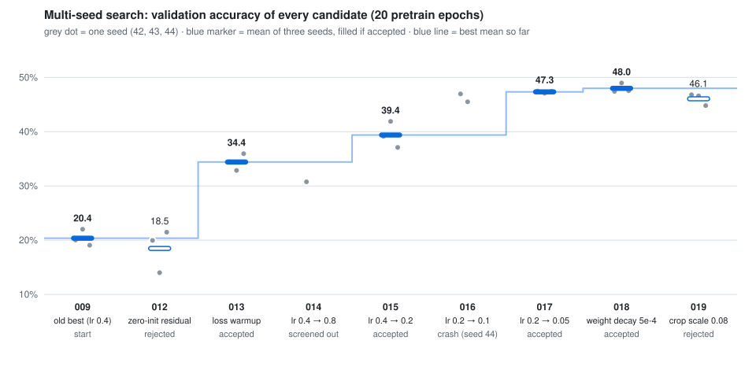
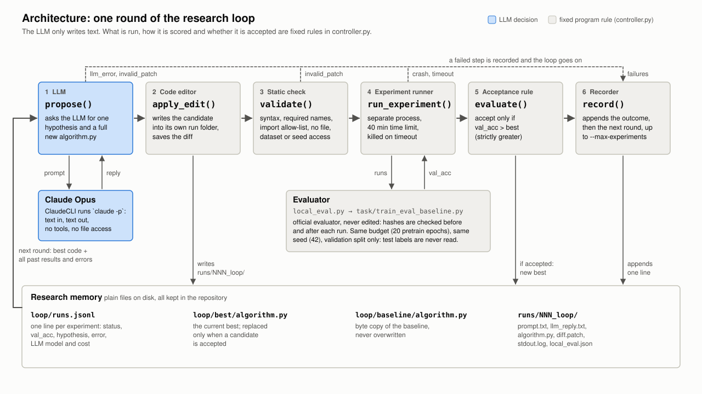
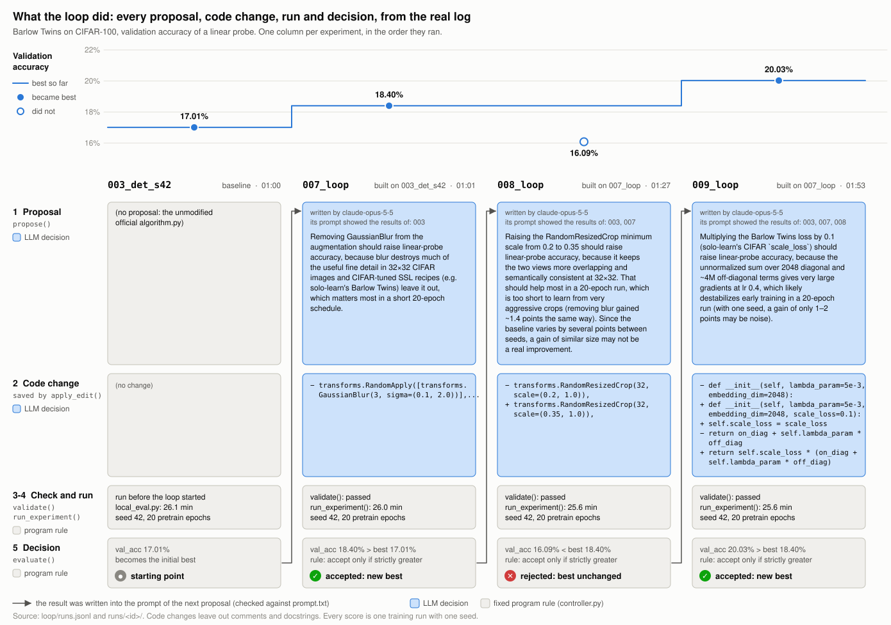

# Figures

Both figures are drawn by [tools/make_figures.py](../tools/make_figures.py):

```
python tools/make_figures.py --png
```

The figure of the multi-seed search is drawn by
[tools/make_search_figure.py](../tools/make_search_figure.py) from
`loop_multiseed/runs.jsonl`; only the short label of each change is typed by hand.



## Architecture (Part 2A)



One round has six steps, each a function in [controller.py](../controller.py). Only step 1
is a decision by the LLM; steps 2 to 6 are fixed rules.

| Step | Component | Function | Who decides |
|---|---|---|---|
| 1 Propose | LLM | `propose()` (`build_prompt()`, `ClaudeCLI`, `parse_reply()`) | LLM |
| 2 Modify | Code editor | `apply_edit()` | program |
| 3 Check | Static check | `validate()` | program |
| 4 Execute | Experiment runner + evaluator | `run_experiment()` → `local_eval.py` → `task/train_eval_baseline.py` | program |
| 5 Evaluate | Acceptance rule | `evaluate()` | program |
| 6 Record | Research memory | `record()` → `loop/runs.jsonl` | program |

## Timeline of the real run (Part 3)



The figure is generated from `loop/runs.jsonl` and the files in `runs/<id>/`; nothing in it
is typed by hand. An arrow from one column to the next is drawn only if that result
appears in the next proposal's `prompt.txt`.

### One example: the rejected run 008 and what happened next

- **Proposal.** After removing blur had worked (007, 18.40%), the LLM proposed another
  change of the same kind: make the random crops milder (`scale` 0.2 → 0.35). Its
  hypothesis cites the 007 result as the reason.
- **Result.** 16.09%, below the best of 18.40%. `evaluate()` rejected it and
  `loop/best/algorithm.py` stayed at 007.
- **Next proposal.** The prompt for 009 listed 008 as rejected. The LLM received the
  code of 007, not of 008, so the crop change was dropped, and it tried a different idea
  (scale the loss by 0.1) that reached 20.03%.

What this shows about the loop: a failed idea costs one run and cannot damage the best
version, because the program, not the LLM, decides what is kept and what the next
proposal starts from.

What it does not show: that either accepted change is a real improvement. Every score
is one run with seed 42. The unchanged baseline, with the same seed, scored between
17.01% and 18.80% in three runs (001–003), and 9.5% on seeds 43 and 44 (see the README).
The two accepted steps are +1.4 and +1.6 points (+3.0 in total), so each single step is
within what the baseline does by itself.
