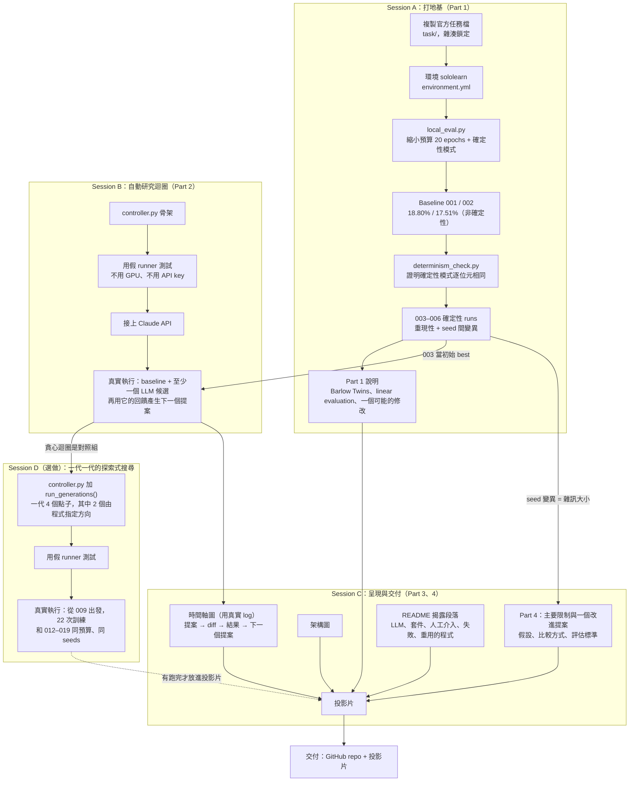
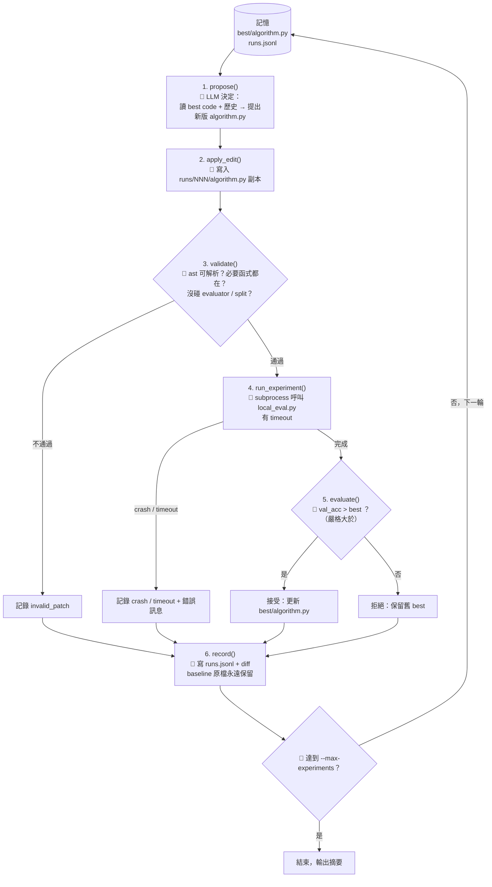
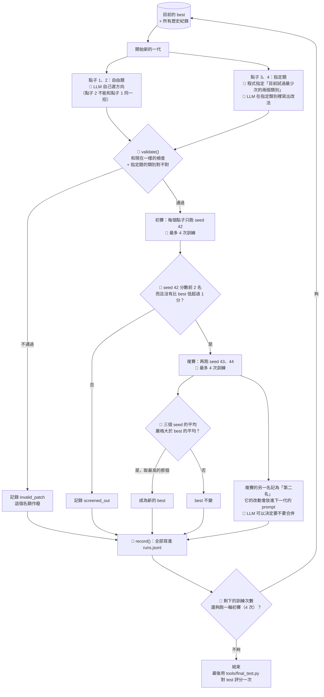

# 專案規劃

這份文件是整個作業的工作規劃，對應題目的 Part 1–4。進度以 GitHub issues 追蹤。

## 圖 1：三個階段

## 圖 2：controller.py 每一輪做什麼

🤖 是 LLM 做的決定，🔧 是寫死的程式規則。

## Session D（選做）：一代一代的探索式搜尋

想法來自 OpenEvolve [5]：一次養一批候選、先篩再選、下一代參考上一代。不採用它的框架，
只把這個做法加進自己的 controller。

### 現在的程式為什麼沒有真的探索

`loop_multiseed/runs.jsonl` 裡 8 個候選的紀錄：

| 事實 | 數字 |
|---|---|
| 探索規則被觸發的次數 | 0 次（8 個候選的 `explore` 欄位都是 false） |
| 候選的類別 | optimisation 6 個、architecture 1 個、augmentation 1 個、loss 0 個 |
| 被接受的 4 個候選 | 全部是 optimisation（warmup、學習率兩次、weight decay） |

原因有三個：

1. **探索是「失敗後才啟動」。** 規則是連續 2 個候選沒進步才要求換方向。這次一直有進步，
   所以從頭到尾沒啟動。
2. **方向由 LLM 自己挑。** 它發現調學習率有效，就一直調下去。
3. **只有一條線。** 每一輪都從目前的 best 往下改，同一時間只有一個點子在比。

### 新的做法：一代 4 個點子

🤖 是 LLM 做的決定，🔧 是寫死的程式規則。

**三個重點：**

- **探索變成固定配額。** 每一代一定有 2 個點子落在最少試過的類別，不管前面成功或失敗。
- **同一代的點子互相看不到分數。** 4 個點子都從同一個 best 出發，是真的「同時比」，
  不是一個接一個修。
- **先便宜篩、再花錢確認。** 初賽 1 次訓練就淘汰一半，所以同樣的 GPU 時間可以試更多點子。

**預算怎麼分（總共 22 次訓練，和貪心那組一樣）：**

| 代 | 初賽 | 複賽 | 累計 |
|---|---|---|---|
| 第 1 代 | 4 次 | 最多 2 個點子 × 2 次 | 8 |
| 第 2 代 | 4 次 | 最多 2 個點子 × 2 次 | 16 |
| 第 3 代 | 4 次 | 只夠 1 個點子 × 2 次 | 22 |

最多試 12 個點子；貪心那組同樣 22 次訓練試了 8 個。

### 實驗程序

1. **寫程式。** 在 controller.py 加 `run_generations()` 和對應的參數。六個步驟的函式
   （`propose`、`apply_edit`、`validate`、`run_experiment`、`evaluate`、`record`）沿用，不改寫。
2. **假 runner 測試。** 不用 GPU、不用 API。要測到：指定類別有沒有被遵守、前 2 名怎麼選、
   預算用完會不會停、中斷後能不能接著跑。
3. **真實執行。** 從 009 出發，seeds 42 / 43 / 44，上限 22 次訓練，狀態存在新的資料夾
   `loop_explore/`。約 9.5 GPU 小時，中途不介入。
4. **最後評分。** 新的 best 用 `tools/final_test.py` 對 test 評分一次，不用來做選擇。
5. **寫進 README 和圖。** 兩組並排的表，加上兩組各自試過哪些類別。

### 對照方式

對照組已經存在：012–019（貪心、從 009 出發、同樣的 seeds、22 次訓練）。
新的一組只差「點子怎麼產生、怎麼篩」，接受規則一樣是三個 seed 的平均嚴格大於 best。

### 評估標準（跑之前先定）

| 指標 | 貪心組（已知） | 探索組 |
|---|---|---|
| 22 次訓練後 best 的三 seed 平均 | 48.00% | 待測 |
| 試過的點子數 | 8 | 待測（最多 12） |
| 至少試過 1 次的類別數（共 5 類） | 3 | 待測（設計上至少 4） |
| 有候選被接受的類別數 | 1 | 待測 |
| test 分數（最後評一次） | 48.66% | 待測 |

### 已知弱點

- **探索組可能輸。** 貪心組的 48% 是連續 4 步 optimisation 疊出來的。探索組每代只有 2 個
  自由名額，三代下來疊不了那麼多步。論文 [1] 也說：改進容易找到時，貪心比較好。
  輸了也是一個可以報告的結果，但要有心理準備。
- **初賽只看 seed 42。** 這正是 Part 4 指出的雜訊問題。取前 2 名（不是只取第 1 名）可以減輕，
  不能消除。
- **每組只跑一次。** LLM 有隨機性，兩組各一次不足以證明哪種搜尋比較好。
- **起點重複。** 從 009 出發代表會重新發現 warmup 這類已知的改進。這是為了對照公平付的代價。

### 和題目的關係

題目沒有要求這一項，Part 4 也只要一張投影片、一個改進。沒跑完的話，只在投影片放一行
「下一步」，不取代現有的 Part 4。

## 題目要求對照

| 題目要求 | 對應的規劃 |
|---|---|
| Part 1：解釋 Barlow Twins、linear evaluation、一個可能的修改 | A7 |
| Part 1：跑 baseline，報告 val accuracy、指令、硬體、seed、預算 | A3–A6，README |
| Part 2A：一張架構圖（LLM、code editor、runner、evaluator、memory） | C2 |
| Part 2A：五個步驟各自指出函式，區分 LLM 決定與程式檢查 | 圖 2 的 1–6 |
| Part 2B：一個 baseline + 一個 LLM 候選，再用回饋產生下一個提案 | B4 |
| Part 2B：保留 baseline 與 best；處理 invalid patch、crash、timeout；實驗上限 | 圖 2 |
| Part 2C：嚴格大於才接受；官方 evaluator 不改；固定 split、seed、協定；不用 test 標籤 | local_eval.py，evaluate() |
| Part 2D：controller 程式、log、diff、指令；標明重用與自己寫的部分 | record()，C4 |
| Part 3：一張用真實 log 畫的圖，解釋一個成功或失敗 | C1 |
| Part 4：一張投影片：假設、比較、評估標準 | C3 |
| 交付：投影片 + repo；揭露 LLM、套件、人工介入、失敗 | C4、C5 |
