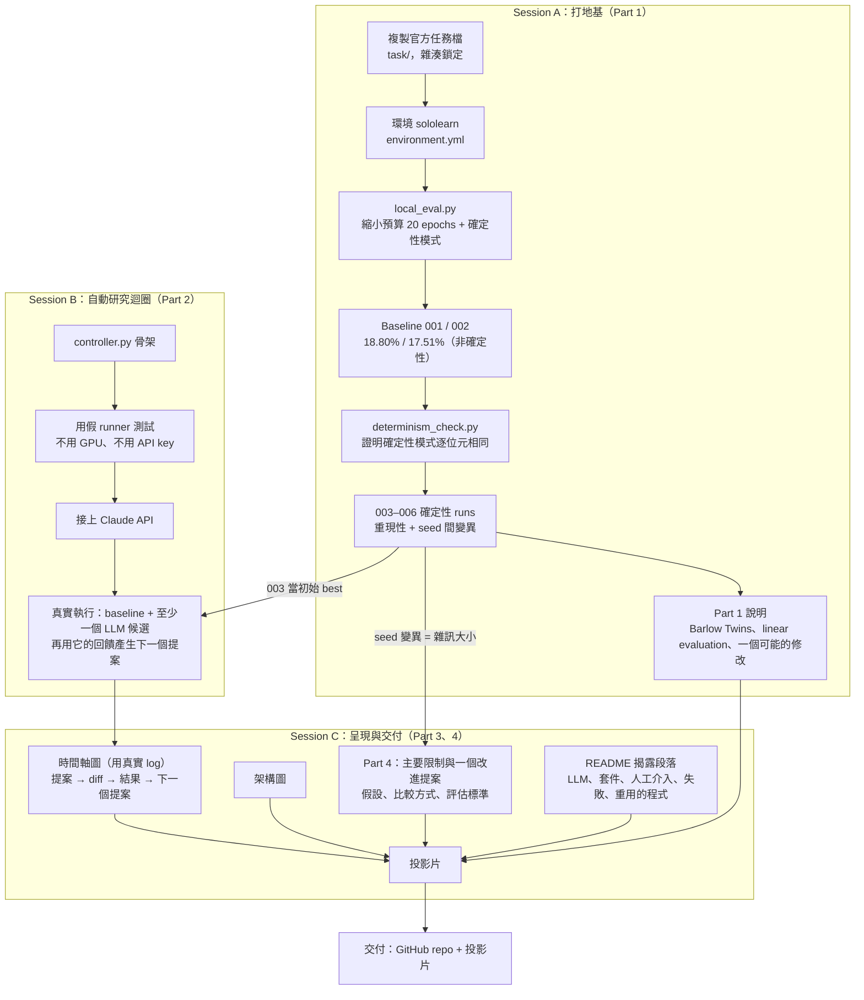
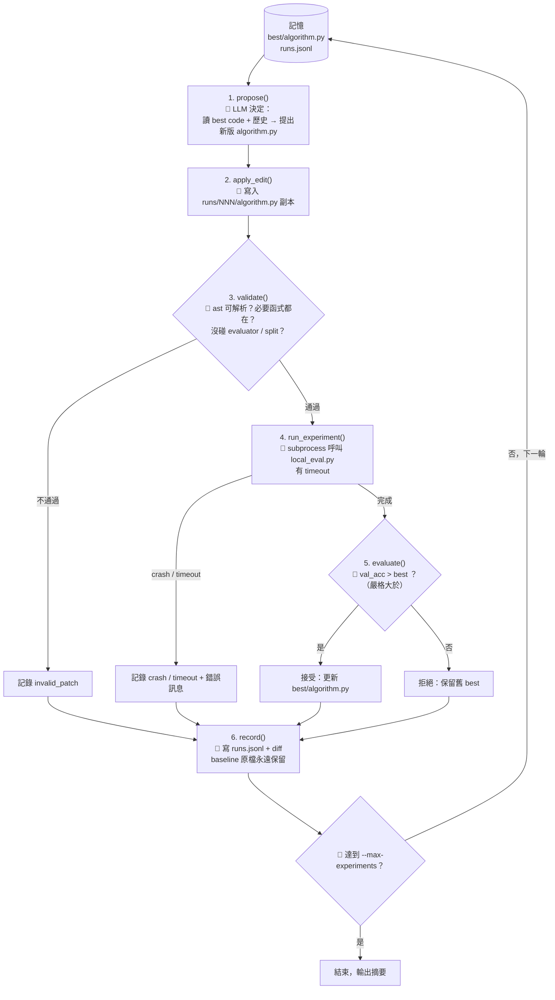

# 專案規劃

這份文件是整個作業的工作規劃，對應題目的 Part 1–4。進度以 GitHub issues 追蹤。

## 圖 1：三個階段

## 圖 2：controller.py 每一輪做什麼

🤖 是 LLM 做的決定，🔧 是寫死的程式規則。

## 題目要求對照

| 題目要求 | 對應的規劃 |
|---|---|
| Part 1：解釋 Barlow Twins、linear evaluation、一個可能的修改 | A7 |
| Part 1：跑 baseline，報告 val accuracy、指令、硬體、seed、預算 | A3–A6，README |
| Part 2A：一張架構圖（LLM、code editor、runner、evaluator、memory） | C2 |
| Part 2A：五個步驟各自指出函式，區分 LLM 決定與程式檢查 | 圖 2 的 1–6 |
| Part 2B：一個 baseline + 一個 LLM 候選，再用回饋產生下一個提案 | B4 |
| Part 2B：保留 baseline 與 best；處理 invalid patch、crash、timeout；實驗上限 | 圖 2 |
| Part 2C：嚴格大於才接受；官方 evaluator 不改；固定 split、seed、協定；不用 test 標籤 | local_eval.py，evaluate() |
| Part 2D：controller 程式、log、diff、指令；標明重用與自己寫的部分 | record()，C4 |
| Part 3：一張用真實 log 畫的圖，解釋一個成功或失敗 | C1 |
| Part 4：一張投影片：假設、比較、評估標準 | C3 |
| 交付：投影片 + repo；揭露 LLM、套件、人工介入、失敗 | C4、C5 |
